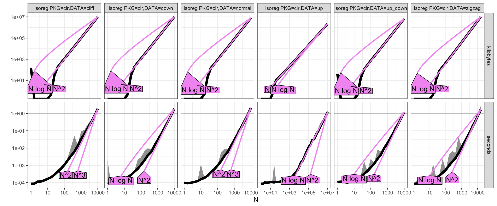
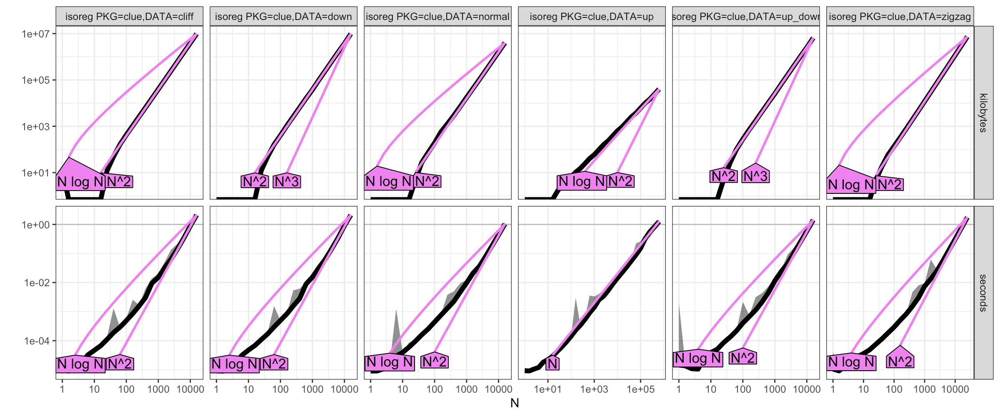
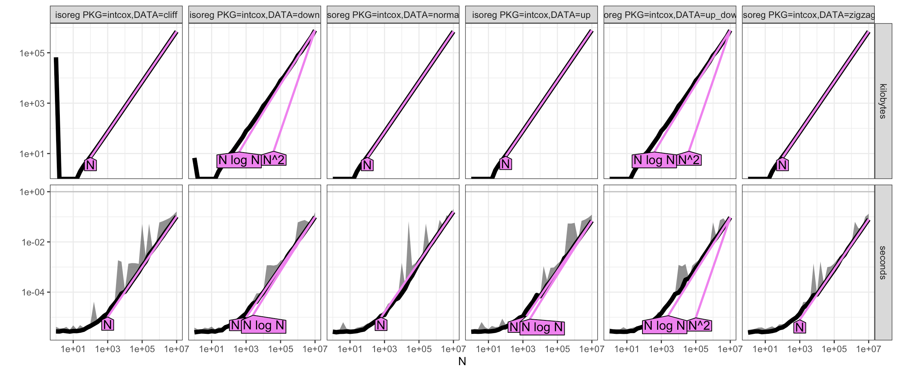
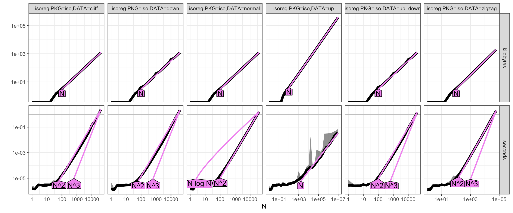
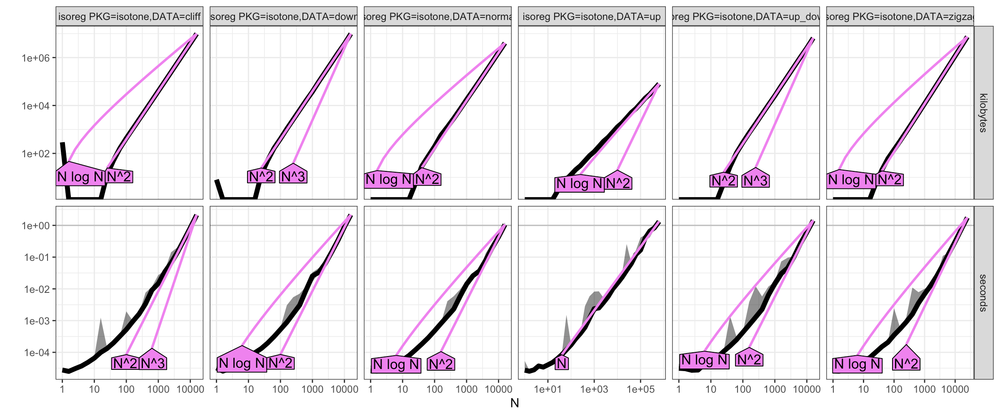
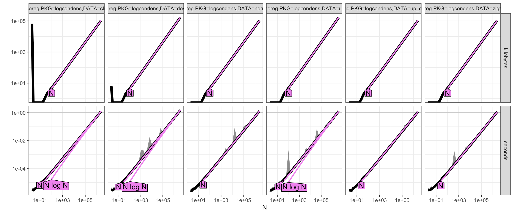
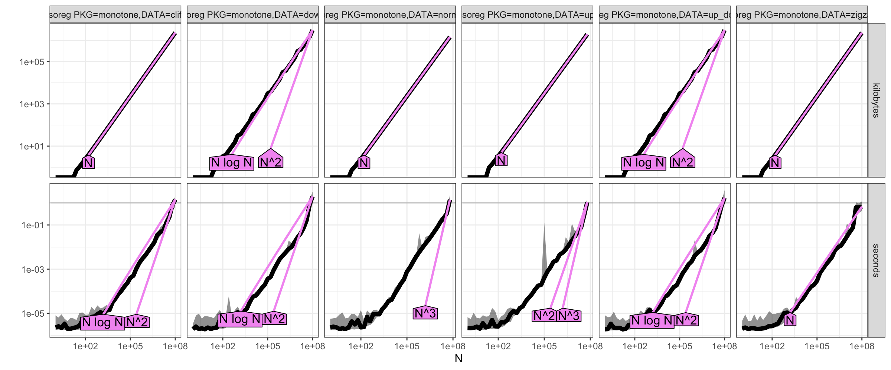
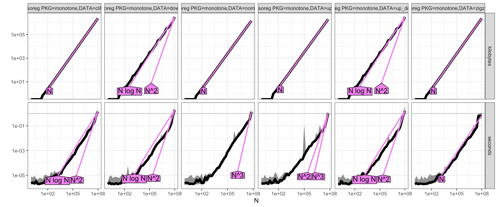
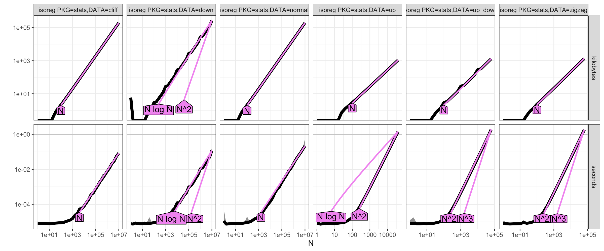

# 2026-10-01

## Hours worked: 2

## Description:
- Present results in FUNCTIONS.md for $O$, $\Omega$ and $\Theta$ for the cases we looked at

## Appendix:

### Results for all R packages according to different datasets on entry

#### `cir`

#### `clue`

#### `directlabels`

#### `fdrtool`

#### `intcox`

#### `iso`

#### `isotone`

#### `logcondens`

#### `monotone`

#### `sagx`

#### `sandwich`

#### `smacof`

#### `stats`
