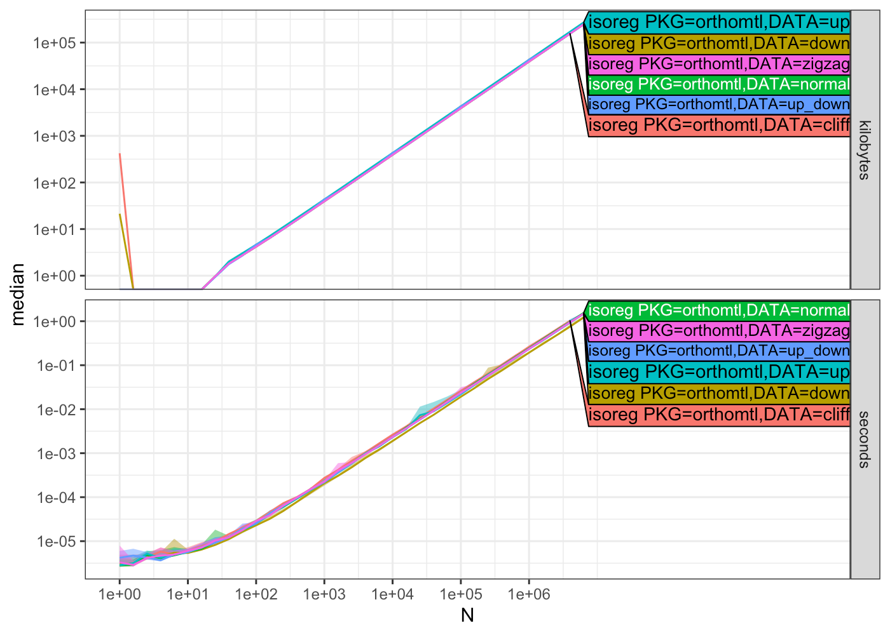
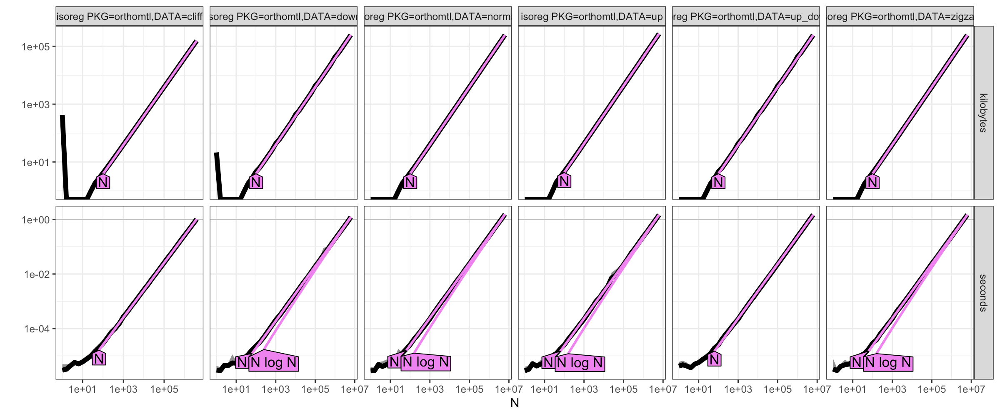
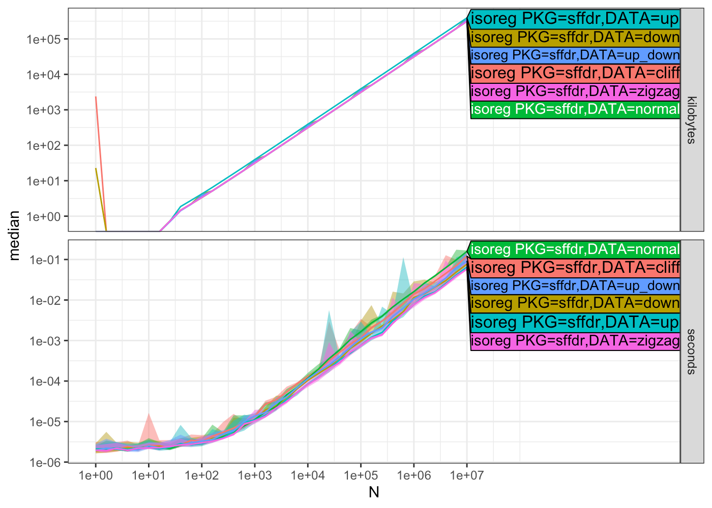
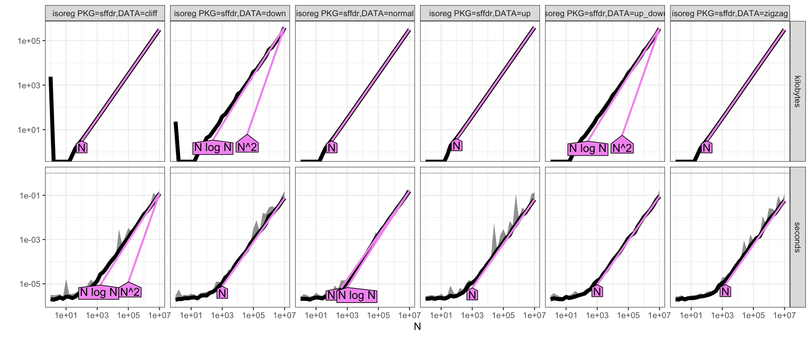
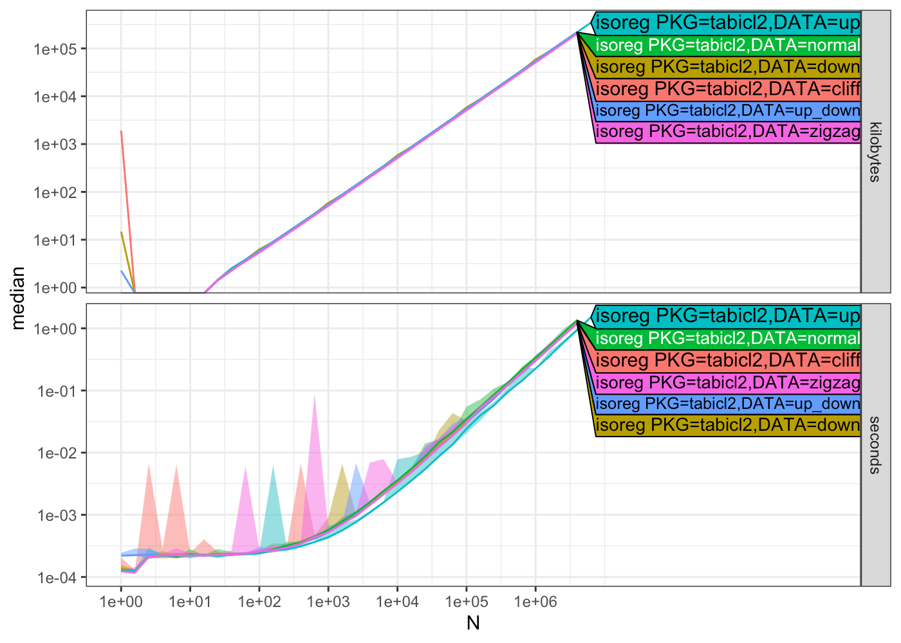
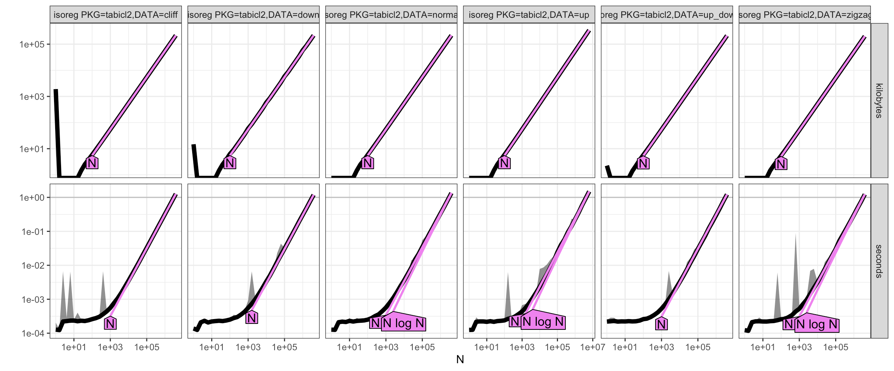
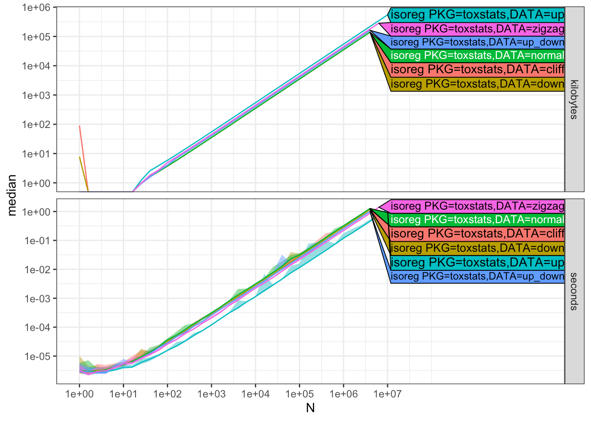
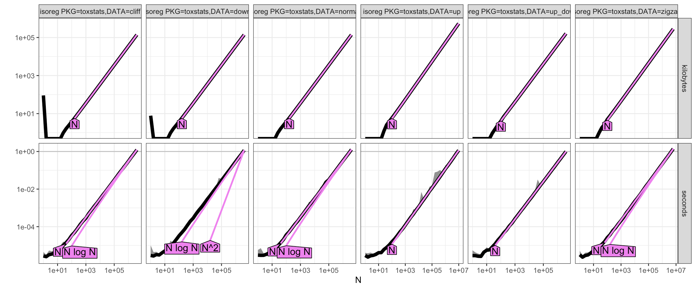

<!-- name of file: yyyy-mm-dd.md -->

# 2026-10-14

## Hours worked: 4

## Description:
- Look at all functions that were described in EXTRA_PAVA_FUNCTIONS.md
- Condense the above-mentioned md file
- Fix comments on PR for adding intcox to monotone.iterations
- Add all relevant O(N) functions from EXTRA_PAVA_FUNCTIONS.md as code, as well as results here, as well as results in FUNCTIONS.md, as well as validating their return in _validation/, running them via _best/
- Describe in the README the steps necessary to adding a function and its results

## Appendix:

### `orthomtl`

### `sffdr`

### `tabicl2`

### `toxstats`

