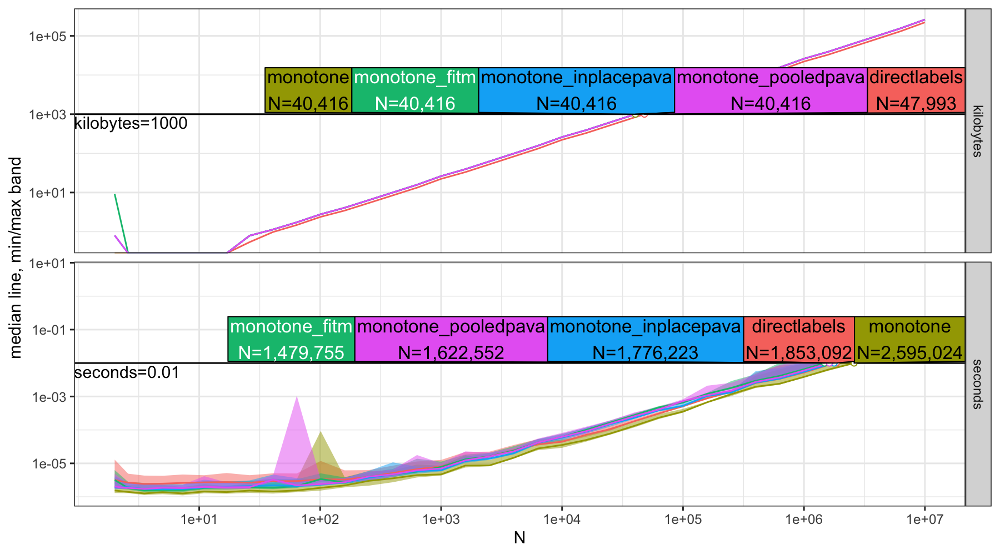
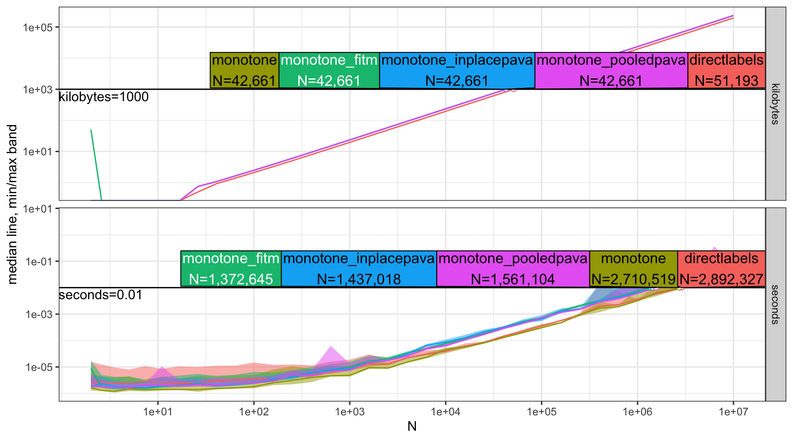
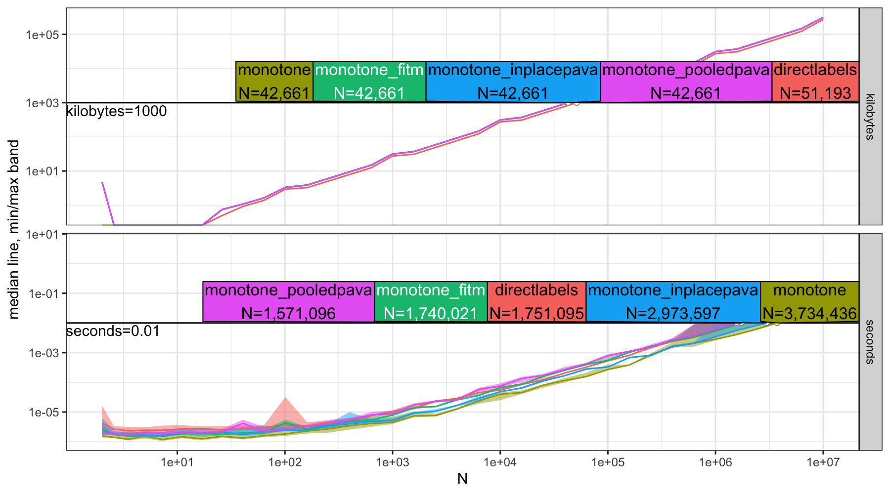
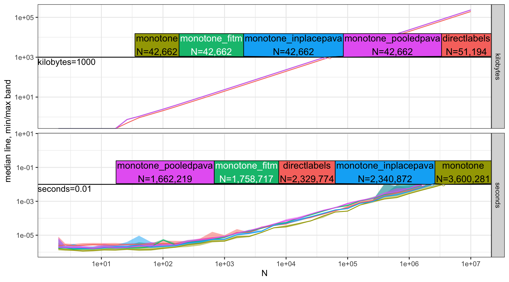
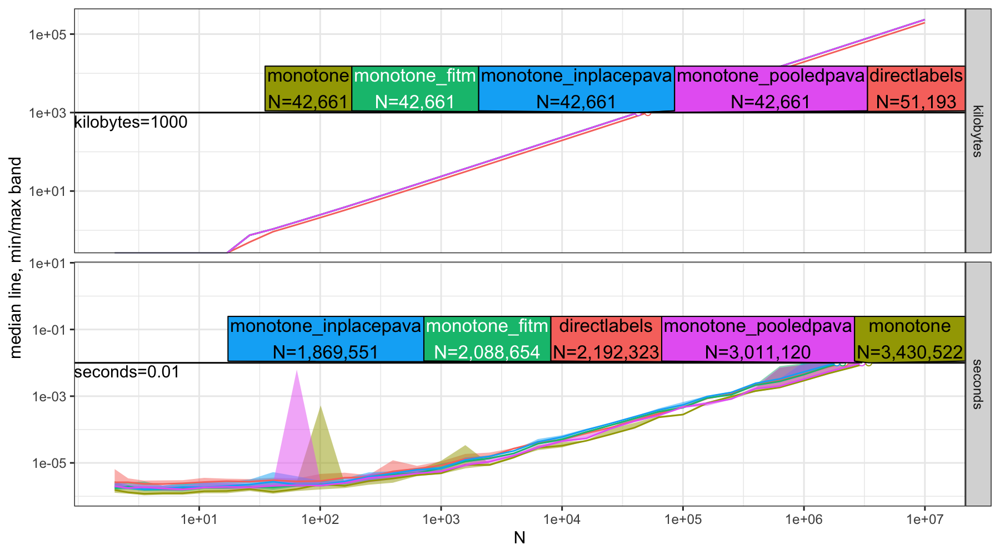

# 2026-11-03

## Hours worked: 6

## Description:
- update versions.md
- remove comparison to baseline in _best/ and regenerate everything
- add directlabels to paper comparison

## Appendix:
### Best results overall

### Best results with top 5 functions for each dataset

#### Cliff:

#### Down:

#### Normal:

#### Up-down:

#### Up:

#### Zigzag:

